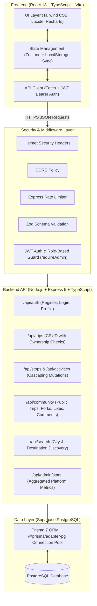

# 🌍 GlobeTrotter — Full-Stack Travel Planning & Community Platform

[](https://github.com/PreetDarji22/Globe_Trotter_/actions/workflows/ci.yml)
[](https://www.typescriptlang.org/)
[](https://react.dev/)
[](https://expressjs.com/)
[](https://www.prisma.io/)
[](https://supabase.com/)

**GlobeTrotter** is a modern, responsive full-stack travel-planning web application engineered to simplify multi-city itinerary building, activity budgeting, and social trip sharing. Designed with a high-aesthetic editorial interface, it empowers travelers to organize day-by-day itineraries, track category-based expenses with real-time analytics, discover global destinations, and fork community-curated travel plans into personalized journeys with a single click.

---

### 🔗 Live Deployments & Repository
- 🚀 **Live Production Application:** [https://globe-trotter-sooty.vercel.app](https://globe-trotter-sooty.vercel.app)
- ⚡ **Live Backend REST API:** [https://globe-trotter-1jjk.onrender.com](https://globe-trotter-1jjk.onrender.com)
- 🐙 **GitHub Repository:** [https://github.com/PreetDarji22/Globe_Trotter_](https://github.com/PreetDarji22/Globe_Trotter_)

---

## 🏛️ System Architecture



---

## 🧠 Key Engineering Decisions

### 1. Prisma 7 with `@prisma/adapter-pg`
- **Rationale**: Utilizing Prisma 7's decoupled driver adapter architecture (`@prisma/adapter-pg` over `pg.Pool`) provides native PostgreSQL connection pooling and low-latency queries across serverless and long-running Node.js environments.
- **Benefits**: Enforces compile-time type safety across complex relational models (`User` ↔ `Trip` ↔ `TripStop` ↔ `Activity`), automated schema migration tracking, and zero manual SQL query vulnerability risks.

### 2. Zustand for Global Client State
- **Rationale**: Chosen over Redux Toolkit due to its minimal boilerplate, hook-based DX, and seamless persistent storage synchronization (`zustand/middleware/persist`).
- **Benefits**: Enables instantaneous multi-city stop reordering, activity budgeting updates, and auth token persistence with zero unnecessary component re-renders.

### 3. Stateless JWT Authentication with Bcrypt
- **Rationale**: Stateless JSON Web Tokens (`jsonwebtoken`) signed with high-entropy cryptographic secrets, combined with salted password hashing (`bcrypt`, 10 rounds).
- **Benefits**: Enables horizontal backend scaling without session store bottlenecks while securely transmitting user identity and role claims (`isAdmin`) to authorize protected resources.

### 4. Hierarchical Budget Aggregation Algorithm
- **Rationale**: Activity expenses are tracked as relational `Decimal` fields linked to specific `TripStops`. When displaying budget overviews, expenses are dynamically aggregated by category (`Transit`, `Food & Dining`, `Sightseeing`, `Stays`) using Prisma aggregation queries on the backend and client-side memoized reduction pipelines.

---

## 🔒 Security Hardening & Vulnerability Remediation

During the transition from hackathon prototype to production portfolio grade, the application underwent a comprehensive security audit and hardening pass:

1. **Eliminated Credential Fallbacks**:
   - Removed all hardcoded database connection strings and fallback JWT signing secrets from source files (`prisma.ts`, `auth.ts`, `middleware/auth.ts`).
   - Implemented fail-fast environment validation ensuring the server immediately throws on missing `DATABASE_URL` or `JWT_SECRET`.
2. **Fixed Account Takeover & Mutation Flaws**:
   - **Login Fix**: Resolved an issue where invalid credentials would mutate user passwords; login now performs strict constant-time `bcrypt.compare` checks and returns generic `401 Unauthorized` responses without user enumeration leaks.
   - **Registration Fix**: Replaced silent password overwrites on existing emails with an explicit `409 Conflict` status code.
3. **Enforced Granular Resource Ownership**:
   - Audited all mutation endpoints (`POST`, `PUT`, `DELETE` on trips, stops, activities, and comments) to verify `resource.userId === req.user.id` before committing mutations, preventing unauthorized cross-user data manipulation (BOLA/IDOR).
4. **Role-Based Access Control (RBAC) & Real Metrics**:
   - Added an `isAdmin` boolean field to the Prisma `User` model.
   - Guarded `/api/admin/stats` with a strict `requireAdmin` middleware.
   - Replaced placeholder statistics with real Prisma aggregate queries (`groupBy`, `_count`, `_avg`, `_sum`).
5. **Defensive API Hardening**:
   - Integrated `helmet` for secure HTTP headers (XSS filter, Content Security Policy, frameguard).
   - Configured `express-rate-limit` on authentication endpoints to prevent brute-force attacks.
   - Enforced request body limits (`50kb`) and strict input validation via `zod` schemas.

---

## 🧪 Testing Suite & CI/CD Pipeline

GlobeTrotter features an automated test runner built on **Vitest** for fast, native TypeScript execution.

### Backend Integration Tests (`backend/tests/`)
- **Authentication**: Validates registration, duplicate email rejection (`409`), credential verification, invalid password rejection (`401`), and input validation (`400`).
- **Authorization & Ownership**: Verifies private trip access control, cross-user modification rejection (`403`), and cascading stop/activity deletions.
- **Admin Access**: Tests role-based authorization ensuring non-admins receive `403 Forbidden` and admins receive real platform aggregations.

### Frontend Component Tests (`frontend/src/__tests__/`)
- **Login Component**: Validates mode toggling, form field interactions, submission handling, and error toast rendering using React Testing Library.
- **Itinerary Builder**: Verifies dynamic section addition, date manipulation, and city search integration.

### CI/CD Workflow (`.github/workflows/ci.yml`)
- Automated GitHub Actions run on every push and PR:
  - TypeScript compilation and type checking (`tsc --noEmit`)
  - Full backend and frontend test execution
  - Production frontend asset build verification

---

## 🛠️ Local Development & Setup

### Prerequisites
- Node.js 18+ & npm
- PostgreSQL database instance (or Supabase project)

### 1. Backend Setup
```bash
cd backend
npm install
cp .env.example .env
# Fill in your DATABASE_URL and JWT_SECRET in .env

# Generate Prisma Client & Push Schema
npx prisma generate
npx prisma db push

# (Optional) Seed Default Cities & Demo Users
npx tsx src/seed.ts

# Start Development Server
npm run dev
```

### 2. Frontend Setup
```bash
cd frontend
npm install
npm run dev
```
Visit `http://localhost:5173` to explore the application.

---

## 🚀 Key Features

| Feature | Description |
| :--- | :--- |
| **Multi-City Itinerary Builder** | Create day-by-day travel plans with custom ordering, dates, and destination highlights. |
| **Dynamic Budget Breakdown** | Real-time expense tracking categorized by Transit, Food, Stays, and Activities with budget warnings. |
| **Social Community Hub** | Browse public community itineraries, like and comment on trips, and fork itineraries into personal plans. |
| **Interactive Analytics** | Admin platform analytics displaying user signup trends, top destinations, and category spending distributions. |
| **Destination Discovery** | Search and filter global destination activities by region, cost index, and activity category. |

---

## 🔮 Known Limitations & Roadmap

- **External Travel API Integration**: Currently uses relational destination database models with Unsplash imagery. Future versions will integrate live flight and hotel pricing APIs (Amadeus / Google Places API).
- **Offline PWA Support**: Implement service worker caching for offline access to itineraries while traveling without active cellular data.
- **Collaborative Real-Time Editing**: Introduce WebSockets (Socket.io) for multi-user real-time itinerary editing with travel buddies.

---

## 📄 License
This project is open-source and available under the [MIT License](LICENSE).
